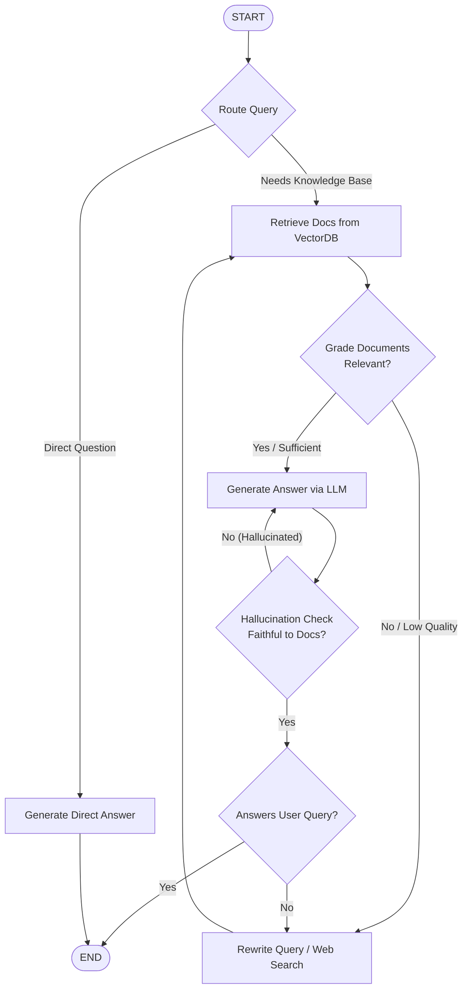

# Modern LangChain + LangGraph + Agentic RAG Learning Plan

> [!IMPORTANT]
> **Modern Stack Requirements (2024–2026 standards):**
> * **LangChain 0.3+** (Modular packages: `langchain-core`, `langchain-community`, `langchain-google-genai`).
> * **LangGraph 0.2+** (`StateGraph`, `START`, `END`, `MessagesState`, `Command`, `MemorySaver`).
> * **NO legacy code**: Avoid `RetrievalQA`, `LLMChain`, `AgentExecutor`, and raw prompt formatting strings. Everything uses **LCEL** (LangChain Expression Language) and **`.with_structured_output()`**.

---

## Architecture Overview: What You Are Building



---

## 10-Day Daily Learning Curriculum

### Phase 1: Modern LangChain & Document Pipelines (Days 1–3)

#### Day 1: Document Ingestion, Chunking & Embeddings
* **Concepts**:
  * Token-aware vs. character-based text splitting.
  * Splitting code vs. markdown vs. raw prose (`RecursiveCharacterTextSplitter`).
  * Chunk size, chunk overlap trade-offs.
  * Vector embeddings (Dense vs. Sparse, cosine distance).
* **Official Docs**:
  * [LangChain Text Splitters](https://python.langchain.com/docs/how_to/#text-splitters)
  * [LangChain Embedding Models](https://python.langchain.com/docs/integrations/text_embedding/)
* **Modern API Syntax**:
  ```python
  from langchain_text_splitters import RecursiveCharacterTextSplitter
  from langchain_community.document_loaders import PyPDFLoader

  splitter = RecursiveCharacterTextSplitter(
      chunk_size=1000,
      chunk_overlap=200,
      add_start_index=True,
  )
  docs = splitter.split_documents(raw_documents)
  ```
* **Daily Goal**: Write a script that loads 3 sample documents, chunks them properly, and calculates token counts.

---

#### Day 2: Vector Stores & Modern Retrievers
* **Concepts**:
  * Vector databases: ChromaDB vs. FAISS vs. Qdrant.
  * Retrieval strategies: Top-K similarity, MMR (Maximal Marginal Relevance) for diversity, metadata filtering.
* **Official Docs**:
  * [LangChain Vector Stores](https://python.langchain.com/docs/integrations/vectorstores/)
  * [LangChain Retrievers](https://python.langchain.com/docs/how_to/#retrievers)
* **Modern API Syntax**:
  ```python
  from langchain_chroma import Chroma
  from langchain_google_genai import GoogleGenerativeAIEmbeddings

  vectorstore = Chroma.from_documents(
      documents=docs,
      embedding=GoogleGenerativeAIEmbeddings(model="models/gemini-embedding-2"),
  )
  retriever = vectorstore.as_retriever(
      search_type="mmr",
      search_kwargs={"k": 4, "fetch_k": 10}
  )
  ```
* **Daily Goal**: Store chunks in an in-memory/persisted vector store and test semantic query retrieval.

---

#### Day 3: Modern RAG with LCEL & Structured Output
* **Concepts**:
  * LangChain Expression Language (LCEL) pipes (`|`).
  * Dynamic prompt formatting with `ChatPromptTemplate`.
  * Typed structured extraction with `.with_structured_output(PydanticModel)`.
* **Official Docs**:
  * [LCEL Cheatsheet](https://python.langchain.com/docs/how_to/sequence/)
  * [Structured Outputs](https://python.langchain.com/docs/how_to/structured_output/)
* **Modern API Syntax**:
  ```python
  from langchain_core.prompts import ChatPromptTemplate
  from langchain_core.output_parsers import StrOutputParser

  prompt = ChatPromptTemplate.from_template("""
  Answer the question using only the context provided below:
  Context: {context}
  Question: {question}
  """)

  rag_chain = prompt | llm | StrOutputParser()
  response = rag_chain.invoke({"context": docs, "question": "What is X?"})
  ```
* **Daily Goal**: Build a clean, minimal LCEL RAG chain.

---

### Phase 2: LangGraph Core Mechanics (Days 4–6)

#### Day 4: State, Nodes, and Linear Edges
* **Concepts**:
  * The Graph paradigm: Why state machines beat linear chains.
  * Defining graph state with `typing.TypedDict` or `pydantic.BaseModel`.
  * Node functions (pure functions: take state $\rightarrow$ return partial state updates).
  * `START` and `END` nodes.
* **Official Docs**:
  * [LangGraph Quickstart](https://langchain-ai.github.io/langgraph/)
  * [LangGraph Concepts: State & Nodes](https://langchain-ai.github.io/langgraph/concepts/low_level/)
* **Modern API Syntax**:
  ```python
  from typing import TypedDict, List
  from langgraph.graph import StateGraph, START, END

  class GraphState(TypedDict):
      question: str
      documents: List[str]
      generation: str

  def retrieve_node(state: GraphState):
      docs = retriever.invoke(state["question"])
      return {"documents": [d.page_content for d in docs]}

  workflow = StateGraph(GraphState)
  workflow.add_node("retrieve", retrieve_node)
  workflow.add_edge(START, "retrieve")
  workflow.add_edge("retrieve", END)
  app = workflow.compile()
  ```
* **Daily Goal**: Create your first 2-node graph and run inputs through it.

---

#### Day 5: Conditional Edges & State Reducers
* **Concepts**:
  * Branching logic: routing functions returning destination node names.
  * State reducers: `Annotated[list, operator.add]` for appending vs. overwriting state.
  * Passing run-time configurations (`RunnableConfig`).
* **Official Docs**:
  * [LangGraph Conditional Edges](https://langchain-ai.github.io/langgraph/how-tos/branching/)
* **Modern API Syntax**:
  ```python
  def route_after_grading(state: GraphState) -> str:
      if state["needs_web_search"]:
          return "web_search"
      return "generate"

  workflow.add_conditional_edges(
      "grade_documents",
      route_after_grading,
      {
          "web_search": "web_search_node",
          "generate": "generate_node"
      }
  )
  ```
* **Daily Goal**: Implement a branching workflow that chooses different paths based on LLM output.

---

#### Day 6: Visualization, Streaming & State Inspection
* **Concepts**:
  * Rendering Mermaid flowcharts with `app.get_graph().draw_mermaid()`.
  * Streaming tokens vs. streaming graph state updates (`stream_mode="updates"` vs `"values"`).
  * Debugging graph execution trajectories.
* **Official Docs**:
  * [LangGraph Streaming](https://langchain-ai.github.io/langgraph/how-tos/streaming/)
* **Daily Goal**: Inspect step-by-step state output and render the graph visual directly in your terminal/notebook.

---

### Phase 3: Agentic RAG Patterns (Days 7–10)

#### Day 7: Document Relevance Grading (CRAG)
* **Concepts**:
  * LLM-as-a-Judge for retrieval quality.
  * Binary classification (`yes`/`no`) using Pydantic schemas.
  * Filtering out noise before feeding context to the generator.
* **Modern API Syntax**:
  ```python
  from pydantic import BaseModel, Field

  class GradeDocuments(BaseModel):
      """Binary score for relevance check on retrieved documents."""
      binary_score: str = Field(description="Documents are relevant to the question, 'yes' or 'no'")

  structured_llm_grader = llm.with_structured_output(GradeDocuments)
  ```
* **Daily Goal**: Implement a node that grades each retrieved chunk and discards irrelevant ones.

---

#### Day 8: Query Transformation & Web Search Fallback
* **Concepts**:
  * Query re-writing: Optimizing conversational or ambiguous queries into search-optimized queries.
  * External search tool integration (Tavily, DuckDuckGo).
  * Cyclic edges: Loop back to retrieval after rewriting or enriching.
* **Official Docs**:
  * [Corrective RAG (CRAG) Paper & Pattern](https://langchain-ai.github.io/langgraph/tutorials/rag/langgraph_crag/)
* **Daily Goal**: Complete the CRAG loop: if all docs are discarded $\rightarrow$ rewrite query $\rightarrow$ web search.

---

#### Day 9: Self-RAG (Hallucination & Answer Grading)
* **Concepts**:
  * **Grounding check**: Does the generated answer contain facts NOT present in the retrieved docs?
  * **Completeness check**: Does the generated answer actually address the user's initial question?
  * Cyclic retry: If hallucinated, re-generate with tighter temperature/prompts.
* **Official Docs**:
  * [Self-RAG with LangGraph](https://langchain-ai.github.io/langgraph/tutorials/rag/langgraph_self_rag/)
* **Daily Goal**: Connect the double-validation loop to ensure 100% grounded answers.

---

#### Day 10: Multi-Turn Memory & LangGraph Checkpointers
* **Concepts**:
  * Graph persistence with `MemorySaver` / SQLite checkpointer.
  * Maintaining conversation history across multi-turn chats with `thread_id`.
  * Human-in-the-loop: Interrupting graph execution for user confirmation before calling external actions.
* **Official Docs**:
  * [LangGraph Persistence](https://langchain-ai.github.io/langgraph/how-tos/persistence/)
  * [Human-in-the-loop](https://langchain-ai.github.io/langgraph/how-tos/human-in-the-loop/)
* **Modern API Syntax**:
  ```python
  from langgraph.checkpoint.memory import MemorySaver

  memory = MemorySaver()
  app = workflow.compile(checkpointer=memory)

  # Thread-scoped execution
  config = {"configurable": {"thread_id": "session-1"}}
  response = app.invoke({"question": "Tell me more about it"}, config=config)
  ```
* **Daily Goal**: Test multi-turn conversational Agentic RAG with memory.
