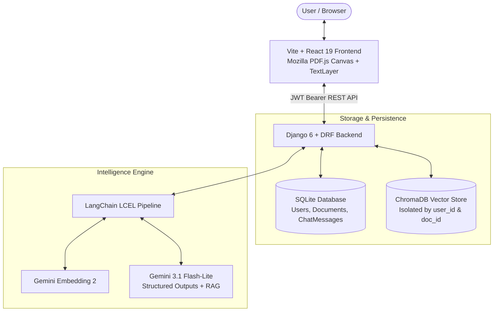

# 📄 DocuLens — AI Document Intelligence & Assistant

> An AI-powered document intelligence and interactive reader platform that extracts structured data and answers grounded questions from PDFs, Markdown, and text documents using **Django**, **LangChain**, and **Google Gemini** — featuring a modern **React.js** dashboard with native text selection.

[](https://python.org)
[](https://djangoproject.com)
[](https://langchain.com)
[](https://ai.google.dev)
[](https://react.dev)
[](https://vite.dev)
[](LICENSE)

---

## 🚀 Features

* **AI-Powered Structured Extraction** — Automatically generates an executive brief, core themes, and tailored questions on upload using `llm.with_structured_output(DocumentSummary)`.
* **Native PDF Canvas & Text Selection** — Overlays an interactive text layer on top of Mozilla PDF.js canvas, letting you highlight any sentence to trigger the floating *"Ask AI"* / *"Set as Context"* popover.
* **Django REST Framework Backend** — Enterprise-grade backend with SQLite ORM persistence for documents, sessions, and chat history.
* **JWT Authentication** — Multi-user security powered by `djangorestframework-simplejwt` with user-isolated document stores.
* **Multi-Tenant Vector Search** — ChromaDB vector store partitioned by user and document ID (`filter={"user_id": user.id, "document_id": doc.id}`) to prevent cross-account data leakage.
* **Fast & Cost-Effective RAG** — Powered by `gemini-3.1-flash-lite` (<2s responses) and `models/gemini-embedding-2` with exponential retry backoff.
* **Modern React 19 Workspace** — Built with Vite 8 and Tailwind CSS, featuring full dark/light mode, collapsible document history sidebar, and rich Markdown parsing.

---

## 🏗️ Architecture



---

## 🛠️ Tech Stack

| Component | Technology | Description |
| :--- | :--- | :--- |
| **Backend Framework** | Django 6 + Django REST Framework | REST APIs, authentication, file storage, and data modeling |
| **Auth System** | `djangorestframework-simplejwt` | Token-based JSON Web Token (JWT) access & refresh tokens |
| **AI Orchestration** | LangChain 0.3 (LCEL) | Declarative runnable pipelines with Pydantic structured outputs |
| **LLM & Embeddings** | Google Gemini (`gemini-3.1-flash-lite`) | Sub-second generative inference and semantic embeddings |
| **Vector Database** | ChromaDB | Local vector store with metadata filtering |
| **Frontend Framework** | React 19 + Vite 8 | Reactive component state, instant HMR, and modular design |
| **PDF Rendering** | Mozilla PDF.js v3.11 | High-DPI canvas rendering with interactive selectable text overlay |
| **Styling** | Tailwind CSS + Lucide Icons | Responsive UI with off-white warm paper aesthetic and dark mode |
| **Markdown Parser** | Marked.js | Renders bold, code blocks, lists, and tables inside chat bubbles |

---

## 📂 Project Structure

```
D:\Projects\DocuLens\
├── backend/                       # Django REST API Backend
│   ├── manage.py
│   ├── doculens_server/           # Project settings, CORS, JWT & URL routing
│   │   ├── settings.py
│   │   └── urls.py
│   └── core/                      # Application core
│       ├── models.py              # User, Document, and ChatMessage ORM models
│       ├── serializers.py         # DRF Serializers for auth, documents & messages
│       ├── views.py               # REST API views with permission checks
│       ├── rag_service.py         # LangChain LCEL chains + Chroma indexing + Gemini
│       └── urls.py                # Core endpoints routing
│
├── frontend/                      # Vite + React 19 Frontend
│   ├── index.html                 # App shell, fonts & PDF.js styling
│   ├── src/
│   │   ├── api.js                 # API service with automatic JWT Bearer injection
│   │   ├── context/
│   │   │   └── AuthContext.jsx    # User login, registration & session state
│   │   ├── components/
│   │   │   ├── Navbar.jsx         # Header with theme toggle & user badge
│   │   │   ├── Sidebar.jsx        # Saved documents list & upload action
│   │   │   ├── PdfViewer.jsx      # PDF.js visual canvas with selectable text layer
│   │   │   ├── ChatWorkspace.jsx  # Markdown chat feed, suggested questions & input
│   │   │   └── AuthModal.jsx      # Sign In / Create Account modal
│   │   ├── App.jsx                # Main layout orchestrator
│   │   └── main.jsx
│
├── .env.example                   # Environment variables template
├── .gitignore                     # Git ignore rules for Python, Django, Node, and secrets
├── CURRICULUM.md                  # 10-Day LangChain & LangGraph Curriculum Guide
└── README.md                      # Project documentation
```

---

## ⚡ Quickstart

### Prerequisites
* **Python 3.11+** installed
* **Node.js 18+** installed
* Google Gemini API Key from [Google AI Studio](https://aistudio.google.com/)

---

### 1. Environment Configuration

Copy the `.env.example` file to `.env`:

```bash
cp .env.example .env
```

Add your Gemini API key:
```env
GOOGLE_API_KEY="your-google-gemini-api-key"
```

---

### 2. Backend Setup (Django)

In your terminal:

```bash
cd backend

# Apply database migrations
python manage.py migrate

# Start the Django development server
python manage.py runserver 127.0.0.1:8000
```

The Django REST API will be running at **`http://127.0.0.1:8000/api/`**.

---

### 3. Frontend Setup (Vite + React)

In a second terminal:

```bash
cd frontend

# Install dependencies (if not already installed)
npm install

# Start Vite development server
npm run dev
```

Open **`http://localhost:5173`** in your browser.

---

## 📡 API Endpoints

| Method | Endpoint | Description | Auth Required |
| :--- | :--- | :--- | :--- |
| `POST` | `/api/auth/register/` | Register new user account | No |
| `POST` | `/api/auth/login/` | Obtain JWT access and refresh tokens | No |
| `POST` | `/api/auth/refresh/` | Refresh expired access token | No |
| `GET` | `/api/auth/me/` | Fetch current user profile | Yes (Bearer) |
| `GET` | `/api/documents/` | List all documents uploaded by user | Yes (Bearer) |
| `POST` | `/api/documents/upload/` | Upload document, chunk, embed & generate summary | Yes (Bearer) |
| `GET` | `/api/documents/<id>/` | Fetch document metadata and full text | Yes (Bearer) |
| `DELETE` | `/api/documents/<id>/` | Delete document and associated chats | Yes (Bearer) |
| `GET` | `/api/documents/<id>/messages/` | Fetch chat history for document | Yes (Bearer) |
| `POST` | `/api/documents/<id>/ask/` | Ask question with optional pinned focus text | Yes (Bearer) |

---

## 🧭 10-Day LangChain/LangGraph Roadmap

* [x] **Day 1: Naive RAG & Document Splitting** — Chunking strategies, token awareness, Chroma storage.
* [x] **Day 2: Vector Stores & Semantic Retrievers** — MMR retrieval, similarity relevance filtering.
* [x] **Day 3: LCEL & Structured Outputs (Pydantic)** — Pydantic schema enforcement, auto-summary generation.
* [x] **Enterprise Milestone: Architecture Migration** — Django + SimpleJWT + SQLite + React 19 / Vite.
* [ ] **Day 4: LangGraph State & Nodes** — State machines, typed graph state, linear workflows.
* [ ] **Day 5: Conditional Branching & Dynamic Routing** — Routing queries between vector store and web.
* [ ] **Day 6: Streaming & Graph Trajectories** — Real-time state inspection and Mermaid graphs.
* [ ] **Day 7: Corrective RAG (CRAG)** — Document relevance grading with binary judge nodes.
* [ ] **Day 8: Query Transformation & Web Search** — Automated query re-writing and fallback retrieval.
* [ ] **Day 9: Self-RAG (Hallucination Detection)** — Grounding verification and cyclic retry loops.
* [ ] **Day 10: Multi-Turn Memory with Checkpointers** — Conversation threads with persistent SQLite checkpointers.

---

## 📄 License

This project is licensed under the [MIT License](LICENSE).
